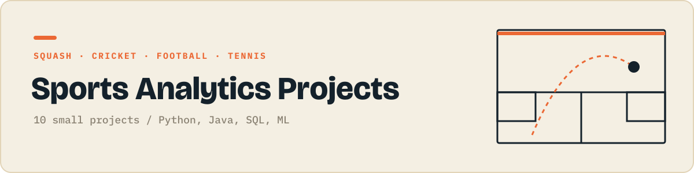

<p align="center"></p>

<p align="center">
  
  
</p>

Squash, cricket, football and tennis through data.

Each folder is one small, self contained project that does one thing. They get harder as the numbers go up: first scripts, then data and charts, then Java, SQL and APIs, then a first machine learning model.

## Projects

| # | Project | What it does | Language | Status |
|:-:|---|---|:-:|:-:|
| 01 | Squash PAR-11 scoreboard | Keeps score of a squash match in the terminal. |  | **next** |
| 02 | Cricket batting average | Calculates batting average and strike rate. |  | ⬜ |
| 03 | World Cup winners chart | Bar chart of FIFA World Cup titles by country. |  | ⬜ |
| 04 | Premier League table | Builds the league table from a CSV of results. |  | ⬜ |
| 05 | Olympic medals by country | Explores which countries win the most medals. |  | ⬜ |
| 06 | NBA player comparison | Compares two players' stats side by side. |  | ⬜ |
| 07 | Tournament bracket generator | Seeds players and prints a knockout draw. |  | ⬜ |
| 08 | IPL: does the toss win the match? | Queries IPL results to test the toss advantage. |  | ⬜ |
| 09 | Wimbledon champions scraper | Scrapes the champions table from Wikipedia. |  | ⬜ |
| 10 | Tennis match winner predictor | Predicts the winner from the ranking gap. |  | ⬜ |

✅ done &nbsp;·&nbsp; **next** up next &nbsp;·&nbsp; ⬜ planned

## Running a project

```bash
git clone https://github.com/JilkaTeerth/sports-analytics-projects.git
cd sports-analytics-projects/01-...
```

Every folder has its own README with the exact commands. Python projects need `pip install -r requirements.txt`, Java projects compile with plain `javac`.

---

<sub>Part of a series of six project collections. See them all at [github.com/JilkaTeerth](https://github.com/JilkaTeerth).</sub>
